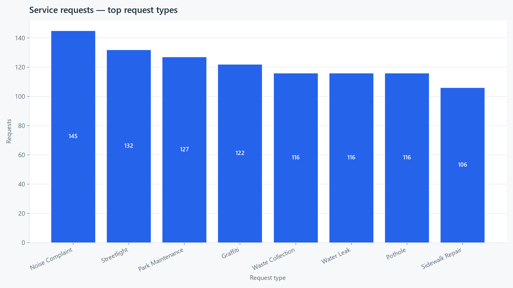
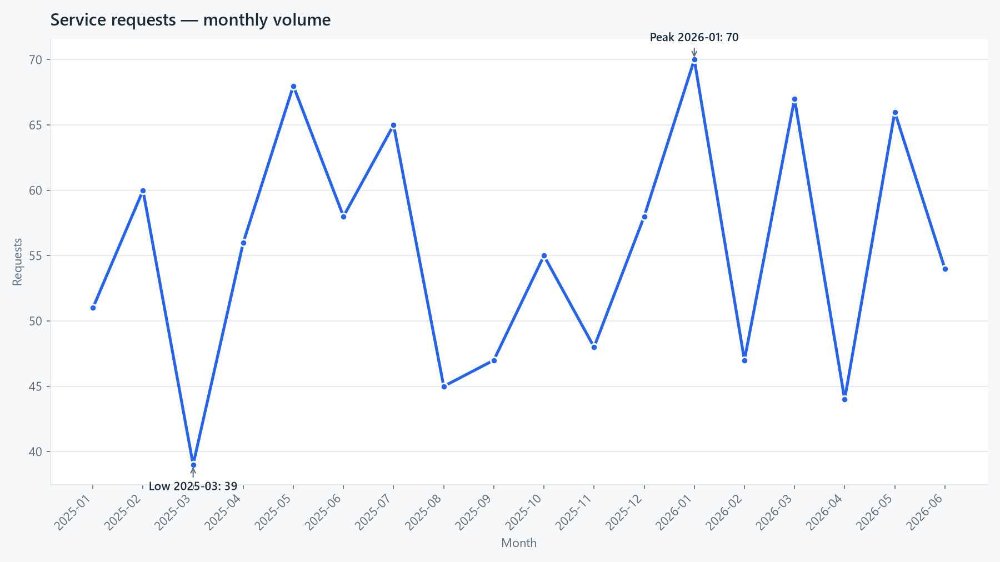
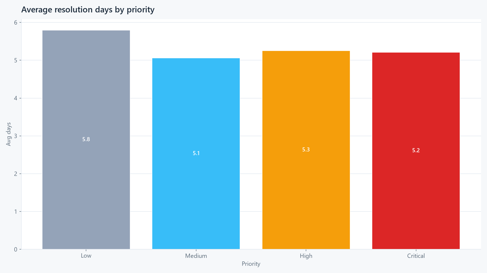

# 311 Service Requests (Google Data Analytics capstone)

For the last course of the Google Data Analytics certificate I had to do a
case study, and I went with the "bring your own data" option. I picked 311
requests because it feels close to the support work I've done. Same story as
every support queue: more tickets than time, and nobody can quite explain why
the backlog never moves.

Fair warning on the data: all 1030 rows are synthetic. I generated them
myself and broke them on purpose, so there's no employer data and no real
people in here.

Tools: SQLite and SQL for cleaning and analysis, Python (pandas, matplotlib)
for checks and charts, Tableau Public for the dashboard.

## Ask

I played the analyst for a fictional city 311 desk. Tickets come in from
different districts and through different channels, and I wanted to answer
three plain questions: what comes in most and through which channels, whether
high-priority tickets actually get fixed faster, and how big the backlog is
and where it sits.

Concretely: measure volume, resolution time, and backlog by type, priority,
and month on 1000 clean tickets from Jan 2025 to Jun 2026, and come out with
3 recommendations. Every number below comes from a query I ran.

## Prepare

The raw file is `data_raw/requests_raw.csv`: 1030 rows, 10 columns (request
id, created and closed dates, district, type, channel, status, priority, a
raw response-days column, satisfaction). I documented every column and every
defect I planted in `data_raw/data_dictionary.md`, and the generator script
`gen_raw.py` is seeded so it rebuilds byte-identical.

I went synthetic because I wanted the whole messy workflow: mixed date
formats, "Phone" vs "phone" casing noise, nulls, dupes, impossible dates
like 2025-02-30, a couple of negative day counts, one ancient status value.
Cleaning that by hand teaches more than a tidy CSV. Clean output is
`data_clean/requests_clean.csv` (1000 rows) and the `service-requests.db`
SQLite database.

## Process

Cleaning lives in `sql/cleaning.sql`, run through `build_clean.py`. What it
does: trims and lowercases every text key and maps them to canonical labels
(null priority falls back to Medium, which cost me some sleep but deleting
20+ tickets over a missing priority felt worse), parses dates strictly in
the three formats present (2025-02-30 becomes NULL instead of silently
rolling into March), nulls negative response days and out-of-range
satisfaction instead of deleting those rows, derives `resolution_days` and
`created_month`, and dedupes on `request_id` keeping the first occurrence.

Flagged rows go to `requests_flags` (121 total) so nothing vanishes quietly:

| What | Rows | Handling |
|---|---|---|
| Duplicates | 30 | removed (1030 down to 1000) |
| Closed tickets with no close date | 26 | kept, left out of resolution math |
| Missing request type | 22 | Unknown (20 left after dedupe) |
| Missing district | 21 | Unknown |
| Missing channel | 17 | Unknown |
| Negative response days | 2 | nulled (-5, -2) |
| Bad created dates | 2 | nulled (2025-02-30, 2025-13-01) |
| Stale status value | 1 | mapped to Other |

`build_clean.py` prints `raw=1030 clean=1000 flags=121`. If you don't see
that, something changed upstream.

## Analyze

Seven queries in `sql/analysis.sql`, n=1000 unless noted. The short version:

Backlog is 26.1%. Closed 601 (60.1%), Cancelled 137, Open 132 plus In
Progress 129. It piles up exactly where volume is highest: Noise Complaint
has 41 of its 145 still open, Streetlight 36, Graffiti 36.

Two categories run the desk. Noise Complaint 145 (14.5%) and Streetlight
132 (13.2%), then Park Maintenance 127 and Graffiti 122. The top three are
around 40% of everything.

The one that got me: priority doesn't buy speed. Over 741 resolved tickets,
Low averages 5.8 days, High 5.3, Critical 5.2, Medium 5.1, overall 5.3.
Low-priority tickets resolve slowest, which means the queue runs oldest-first
or at random, not by triage. I reran this because I didn't believe it.

Demand never lets up either. 39 to 70 requests a month, every month for 18
months (Jan 2025 to Jun 2026), peak 70 in Jan 2026, low 39 in Mar 2025,
about 55 a month on average. No spike to blame, no quiet season to catch up.

Water Leak is the quality problem. Overall satisfaction is 3.08 out of 5
(726 responses); Water Leak sits at 2.78, worst of any type, while
top-volume Noise Complaint scores best at 3.33. So the fix isn't "everything,"
it's Water Leak jobs specifically.

Phone still leads intake at 220 (22%), with Web 205, In Person 190, Mobile
App 187, Social Media 181 behind it. Digital combined beats phone, so the
self-service bet already reaches most people.

## Share

`analysis.py` regenerates three charts, nothing hardcoded: top request types
sorted with counts on the bars, the 18-month volume line with peak and valley
marked, and the resolution-by-priority bars with the 5.8/5.1/5.3/5.2 values
labeled (that last one is the chart people argue with, so the labels stay).

Tableau mirrors the same three views plus KPI tiles (1000 tickets, 26.1%
backlog, Noise 145) on a 1600x900 dashboard, published here:
https://public.tableau.com/app/profile/daniel.aldana3931/viz/311ServiceRequests-Capstone/311ServiceRequests-Capstone

Here are the Python versions:

I built the dashboard in Tableau Public straight from
`data_clean/requests_clean.csv`; exact clicks in `tableau/TABLEAU-CONNECT.md`.

## Act

Three things I'd push for, in order:

1. Triage for real, starting with Critical. A 5.8 vs 5.2 day inversion means
   triage isn't happening. Get Critical from 5.2 to 4.0 days or less within
   90 days and check by rerunning Q4. Boring, highest leverage.
2. A sprint crew on Noise Complaints. Top volume (145) and top backlog (41).
   Take that 41 down to 28 or fewer this quarter, tracked monthly. One
   category, a third of the backlog conversation.
3. Audit Water Leak jobs end to end. 2.78 on middling volume smells like fix
   quality, not capacity. Post-job callbacks on every Water Leak close,
   target 3.2 or better within two quarters. And the unglamorous form fix:
   require `closed_date` at close time, because 26 Closed tickets are missing
   it and that quietly understates every resolution metric.

Things I'd do differently with more time: pull a second time period to check
the priority finding isn't a fluke, chase the 26 missing close dates instead
of working around them, and look into whether low Water Leak scores cluster
with particular crews or districts. Synthetic data only goes so far.

## Reproduce it

1. `py build_clean.py` (expect `raw=1030 clean=1000 flags=121`)
2. Run `sql/analysis.sql` Q1 to Q7 on `service-requests.db` (zero errors; Q4
   should read Low 5.8 / High 5.3 / Critical 5.2 / Medium 5.1)
3. `py analysis.py` (expect `rows=1000 closed=601 backlog_pct=26.1` and
   `top_type=Noise Complaint (145)`, plus 3 fresh charts)
4. Tableau: follow `tableau/TABLEAU-CONNECT.md` against the clean CSV
